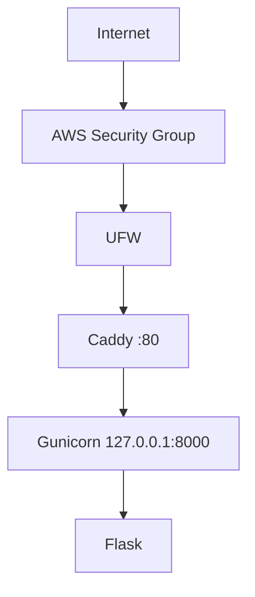

# Architecture v0.1

## Deployment View

## Resource Constraints
- 2 vCPU, sekitar 1 GB RAM, 19 GB disk, swap 1 GB

## Security Decisions
- Administrasi dengan user non-root
- SSH hanya dengan key, password dan root dinonaktifkan
- UFW aktif, backend hanya listen di loopback

## Current Limitations
- HTTP saja, satu server, tanpa database, container, atau CI/CD
- IP publik berubah jika instance dihentikan

## Planned Evolution
M04 DNS dan HTTPS, M05 data, M06 container, M07 IaC, M09 CI/CD
